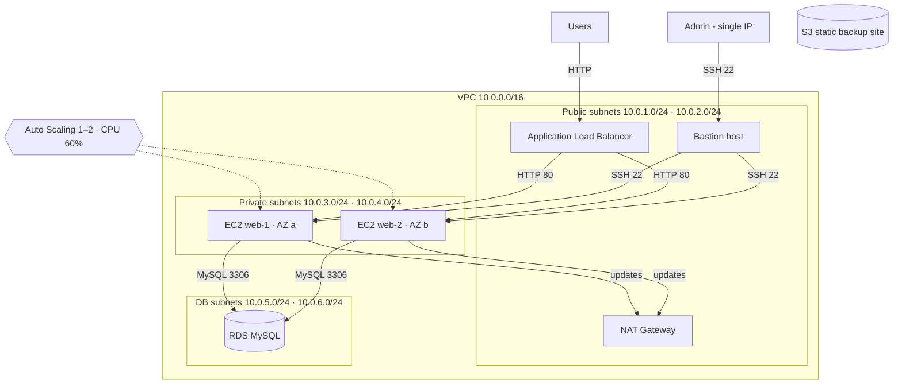
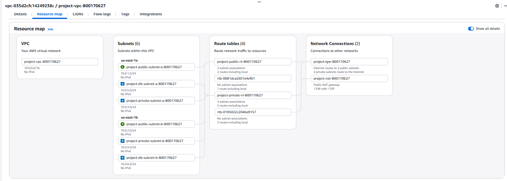
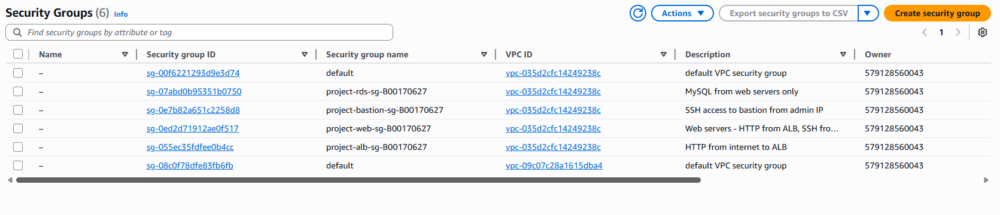
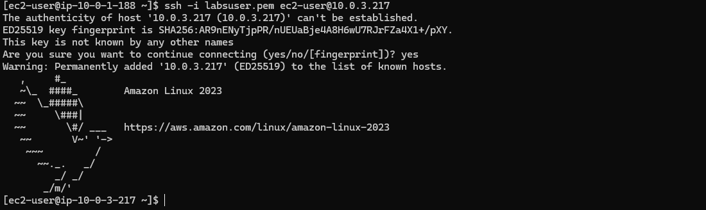
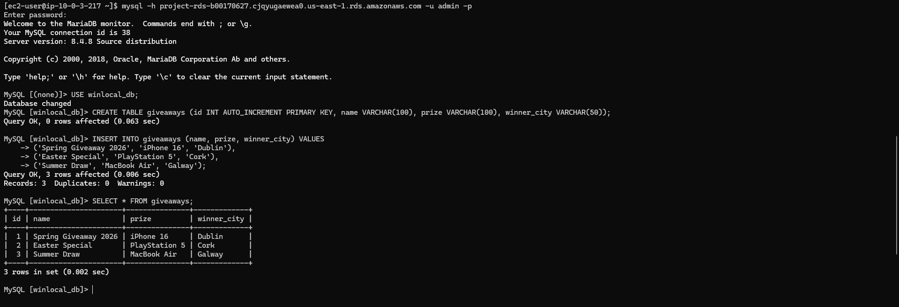
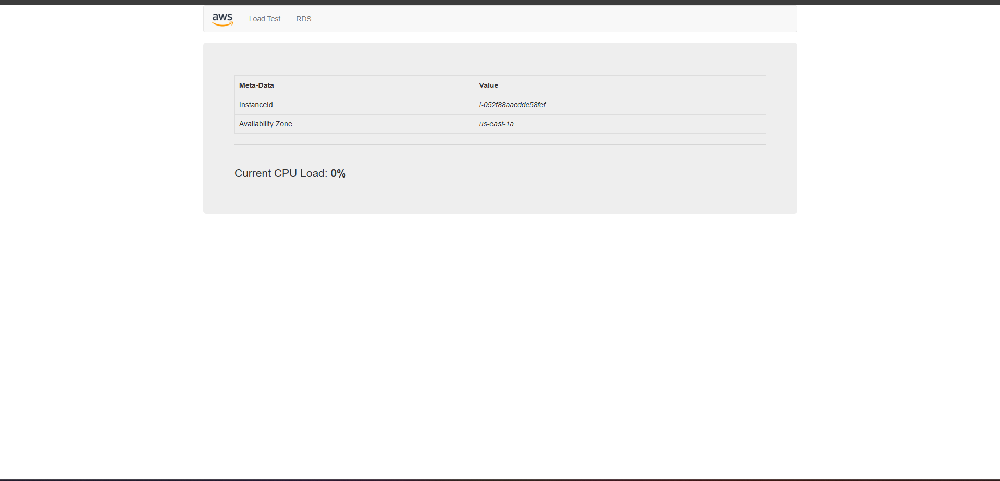
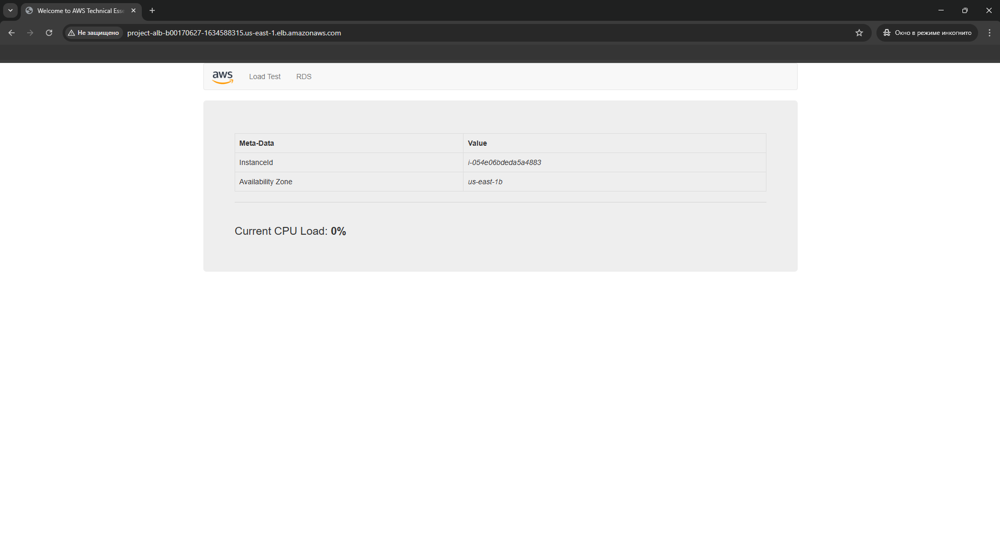
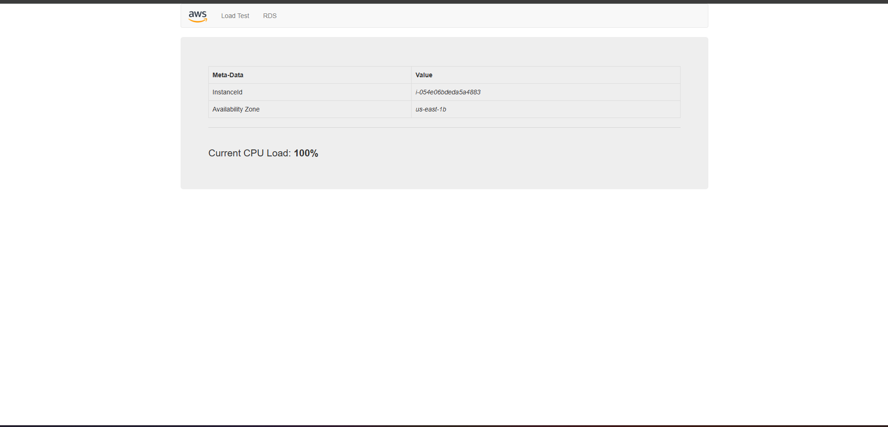
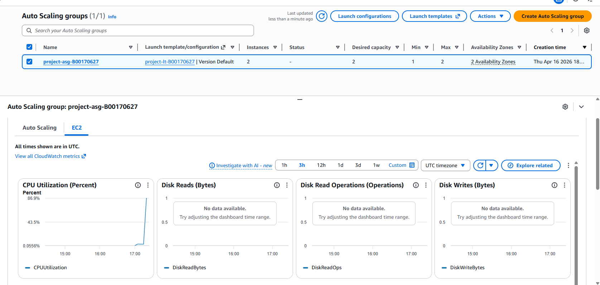

# Secure, Scalable AWS Architecture – Proof of Concept

An AWS architecture design and working proof of concept for a fictional Dublin start-up, "WinLocal Giveaways", moving from on-premises servers to the cloud after a ransomware incident. The design is three-tier and multi-AZ, with a bastion host, load balancing, auto scaling, a managed database and a static backup site.

**Individual project** · Security Architecture (COMP H2701) · TU Dublin · April 2026
**Built in:** AWS Academy Learner Lab (us-east-1)
**Services:** VPC, subnets, route tables, Internet and NAT Gateway, Security Groups, EC2, custom AMI, Application Load Balancer, Auto Scaling, RDS MySQL, S3 static hosting, CloudWatch, IAM

---

## The brief

WinLocal's on-prem setup had four problems:

1. **Availability:** one ageing hardware load balancer, so the site went down when a server failed
2. **Database reliability:** the MSSQL server ran out of disk space
3. **No scalability:** traffic spikes during giveaway campaigns overloaded the servers
4. **A flat network:** ransomware spread across the network and went undetected for 10 weeks

## Architecture

The full diagram, made in draw.io with AWS icons, is in [`diagram/winlocal-aws-architecture.drawio`](diagram/winlocal-aws-architecture.drawio). Open it at [app.diagrams.net](https://app.diagrams.net). It also shows the parts of the design that are conceptual only (Route 53, CloudFront, WAF, Shield, CloudTrail, KMS, Multi-AZ RDS).

## What I built and why

| Component | What I configured | Problem it solves |
|---|---|---|
| **VPC and subnets** | Custom VPC with 6 subnets across 2 AZs: public, private and DB tiers. Public route table goes to the IGW, private route table goes to the NAT Gateway | Replaces the flat network. Each tier is isolated (defence in depth) |
| **Security Groups** | 4 SGs that reference each other instead of IP ranges: Internet → ALB:80 → Web:80; Bastion → Web:22; Web → RDS:3306; SSH to the bastion only from one admin IP | Least privilege. The database is only reachable through the web tier |
| **Bastion host** | EC2 in a public subnet. The web servers have no public IP and are managed by SSH through the bastion | Removes SSH exposed to the internet on every server |
| **Custom AMI** | Golden image with Apache, PHP and the web app pre-installed | New instances are ready in about 2 minutes, so recovery is fast |
| **RDS MySQL** | `db.t3.micro` in a DB subnet group, reachable only from the web SG. The web app reads and writes to it | Managed storage, patching and backups instead of a disk-full on-prem server |
| **Application Load Balancer** | Internet-facing, across 2 AZs, with a health-checked target group | If one web server fails, traffic goes to the healthy one |
| **Auto Scaling Group** | Launch template from the custom AMI. Min 1 / desired 1 / max 2, target tracking at 60% CPU | Handles campaign spikes automatically |
| **S3 static backup** | Static website hosting with a public-read policy on objects only | A maintenance page if the main stack goes down |

## Evidence

| | |
|---|---|
| **VPC resource map**: 6 subnets, 2 AZs, IGW and NAT  | **Security Groups chained by reference**  |
| **SSH from the bastion into a private instance**  | **Web tier reading from RDS**  |
| **ALB sends traffic to web-1 (AZ a)…**  | **…and web-2 (AZ b)**  |
| **Load test pushes CPU to 100%**  | **ASG scales out automatically**  |

All 23 screenshots are in [`screenshots/`](screenshots/) and numbered in build order.

### How I tested it

- **Network isolation:** private instances have no public IP. I could only reach them through the SSH chain laptop → bastion → web-1.
- **Database access:** I connected from web-1 to the RDS endpoint with the MySQL client, then created and queried a table.
- **Load balancing:** refreshing the ALB DNS name returned two different instance IDs in two AZs.
- **Auto scaling:** I used the app's load test to push CPU to 100%. The CloudWatch alarm fired and the ASG launched a second instance, which showed as healthy in the target group.

## Limits of the PoC and what I proposed next

In the written report I justified two services from the diagram that were not built in the lab:

- **AWS WAF on the ALB:** AWS Managed Rules for SQL injection, XSS and bad bots, plus rate-based rules. This filters web attacks before they reach EC2 and stops bot traffic from triggering scale-out the company pays for.
- **AWS CloudTrail and CloudWatch alarms:** these record every API call (new IAM users, Security Group changes, logging disabled). They target the biggest failure in the scenario, an attacker who went undetected for about 10 weeks.

Other known limits:

- **Single-AZ RDS:** in production this should be Multi-AZ, with a synchronous standby and automatic failover.
- **HTTP only:** a real deployment would terminate HTTPS at the ALB or at CloudFront.
- I also wrote a short sustainability review based on the AWS Well-Architected sustainability pillar: right-sized instances, scaling in when traffic is low, and managed services.

## My contribution

The architecture diagram, the proof-of-concept build, the testing and the written justification were all my individual work. A separate group task in the same module mapped WinLocal's security posture to the NIST CSF 2.0 functions in a presentation, and it is not included here.

## Notes on publishing

The screenshots come from a temporary AWS Academy lab environment. I hid my home IP address (the bastion SSH rule) and my browser bookmarks bar before publishing. No keys, `.pem` files or passwords are included.
